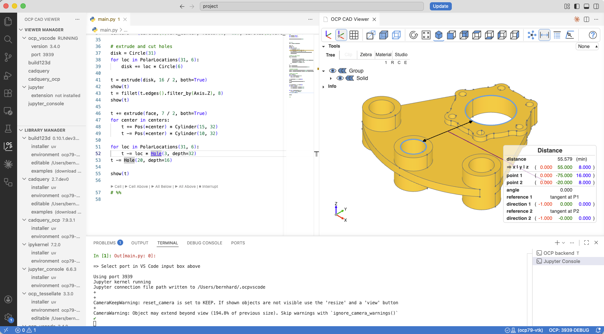
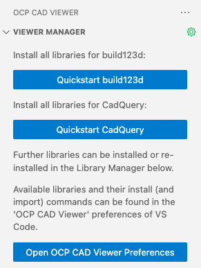
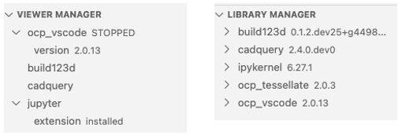
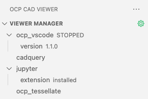
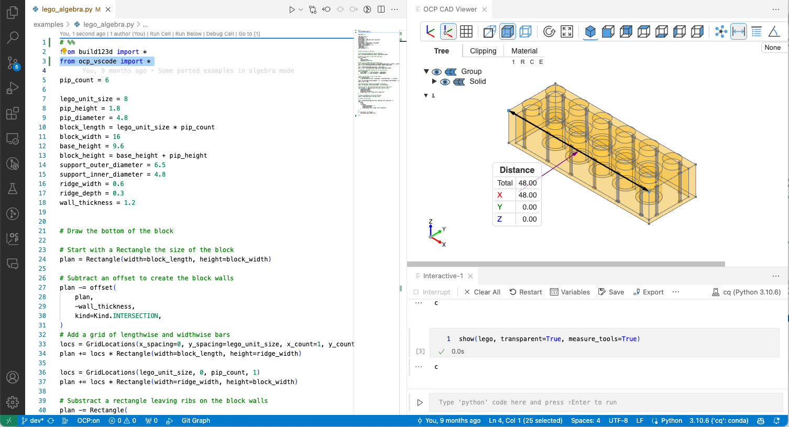

# _OCP CAD Viewer_ for VS Code

_OCP CAD Viewer_ for VS Code is an extension to show [CadQuery](https://github.com/cadquery/cadquery) and [build123d](https://github.com/gumyr/build123d) objects in VS Code via the [three-cad-viewer](https://github.com/bernhard-42/three-cad-viewer) viewer component.



A typical session is just a few lines of Python:

```python
# build123d
from build123d import Box
from ocp_vscode import show

show(Box(1, 2, 3))
```

```python
# CadQuery
import cadquery as cq
from ocp_vscode import show

show(cq.Workplane().box(1, 2, 3))
```

## Installation

### Prerequisites

- Microsoft VS Code, 1.85.0 or newer
- The [Python extension](https://marketplace.visualstudio.com/items?itemName=ms-python.python) installed in VS Code
- Necessary tools: `python` and `pip` or `uv pip`/`uv add` available in the Python environment that will be used for CAD development.

**Notes**:

- To use OCP CAD Viewer, start VS Code from the commandline in the Python environment you want to use or select the right Python interpreter in VS Code first. **OCP CAD Viewer depends on VS Code using the right Python interpreter** (i.e. mamba / conda / pyenv / poetry / ... environment).
- For VSCodium, the extension is not available in the VS code market place. You need to download the the vsix file from the [release folder](https://github.com/bernhard-42/vscode-ocp-cad-viewer/releases) and install it manually.

### Installation within VS Code

1. Open the VS Code Marketplace, and search and install _OCP CAD Viewer 4.2.0_.

    Afterwards the OCP viewer is available in the VS Code sidebar:

    

2. Clicking on it shows the OCP CAD Viewer UI with the viewer manager and the library manager:

    

    You have 3 options:
    - Prepare _OCP CAD Viewer_ for working with [build123d](https://github.com/gumyr/build123d): Press the _Quickstart build123d_ button.

        This will install _OCP_, _build123d_, _ipykernel_ (_jupyter_client_), _ocp_tessellate_ and _ocp_vscode_ via `pip`

        

    - Prepare _OCP CAD Viewer_ for working with [CadQuery](https://github.com/cadquery/cadquery): Press the _Quickstart CadQuery_ button.

        This will install _OCP_, _CadQuery_, _ipykernel_ (_jupyter_client_), _ocp_tessellate_ and _ocp_vscode_ via `pip`

        

    - Ignore the quick starts and use the "Library Manager" to install the libraries via `pip` (per default, this can be changed in the VS Code settings). Install the needed library by pressing the down-arrow behind the library name (hover over the library name to see the button) in the "Library Manager" section of the _OCP CAD Viewer_ sidebar. For more details, see [here](https://bernhard-42.github.io/ocp_viewer_docs/viewers/ocp_vscode/managers/)

    Quickstart will also
    - (optionally) install the the [Jupyter extension for VS Code from Microsoft](https://marketplace.visualstudio.com/items?itemName=ms-toolsai.jupyter)
    - start the OCP viewer
    - create a demo file in a temporary folder to quickly see a simple usage example

**Notes:**

- Do not use the _OCP CAD Viewer_ logo to verify your _OCP CAD Viewer_ settings! The logo overwrites all your settings in VS Code with its own settings to always look the same on each instance. Use a simple own model for checking your configuration

- If you run into issues, see [Troubleshooting](https://bernhard-42.github.io/ocp_viewer_docs/viewers/ocp_vscode/troubleshooting/)

### Installation via CLI

If you aren't using VS Code, you can install/use this extension via command line

Since this is a python extension, it is recommended to install/activate a virtual environment first, (e.g. uv, venv, poetry, conda, pip, etc)

- uv based virtual environemnts:

    ```
    source .venv/bin/activate  # to activate the uv virtual environment
    uv add ocp-vscode
    ```

- pip for other virtual environments:

    ```
    source .venv/bin/activate  # to activate venv virtual environments
    conda / mamba / micromamba activate <env>  # to activate conda like virtual environments
    pip install ocp-vscode
    ```

Notes:

- The extension is in pypi only [pypi](https://pypi.org/project/ocp-vscode/), so for conda, mamba or micromamba environments `pip` or `uv pip` needs to be used.
- If you want to use the Studio mode with MaterialX support, see [PBR Studio](https://bernhard-42.github.io/ocp_viewer_docs/pbr_studio/#material-setup)

### Installation in code-server

This extension is _not_ available on the [OpenVSX marketplace](https://open-vsx.org/) used by code-server. If you want to use it in [code-server](https://github.com/coder/code-server), you need to install it manually on the server running code-server:

1. Go to the [releases page](https://github.com/bernhard-42/vscode-ocp-cad-viewer/releases)
2. Download the latest `ocp-cad-viewer-<version>.vsix` file, e.g. using `wget <url of vsix file>`
3. Run `code-server --install-extension ocp-cad-viewer-<version>.vsix` to install the extension

## Usage

### Running code with VS Code's "Run" menu

The simplest way to run a Python script with OCP CAD Viewer is via VS Code's built-in **Run** menu:

- Edit the file as usual. Make sure `from ocp_vscode import ...` (or `import ocp_vscode`) is somewhere in the file — this matches the default `OcpCadViewer.advanced.autostartTriggers` and starts the viewer automatically when the file is opened.
- Use **Run > Run Without Debugging** (`Ctrl-F5` / on macOS `⌃F5`) for a plain run, or **Run > Start Debugging** (`F5`) to run under the Python debugger with visual debugging enabled (see [docs/debug.md](https://bernhard-42.github.io/ocp_viewer_docs/viewers/ocp_vscode/visual_debugging/)).
- Each `show(...)` call in your script is sent to the running viewer. If more than one viewer is open, `show` prompts in the terminal to choose which port to send to; call `set_port(<port>)` explicitly to skip the prompt.

### Running code using Jupyter extension

- Start the _OCP CAD Viewer_ by pressing the box-arrow button in the "Viewer Manager" section of the _OCP CAD Viewer_ sidebar (hover over the `ocp_vscode` entry to see the button).
- Import ocp_vscode and the CAD library by using the paste button behind the library names in the "Library Manager" section
- Use the usual Run menu to run the code



### Standalone mode

The standalone viewer became its own package, [ocp_viewer](https://github.com/bernhard-42/ocp-viewer): `pip install ocp_viewer`, then `python -m ocp_viewer` starts a server reachable at `http://127.0.0.1:3939`. See [OCP Viewer](https://bernhard-42.github.io/ocp_viewer_docs/viewers/ocp_viewer/installation/) in the documentation, including the full CLI reference and how to run it in Docker.

### Debugging code with visual debugging

After each step, the debugger checks all variables in `locals()` for being CAD objects and displays them with their variable name. See [docs/debug.md](https://bernhard-42.github.io/ocp_viewer_docs/viewers/ocp_vscode/visual_debugging/) for details.

### Library Manager

The "Library Manager" in the _OCP CAD Viewer_ sidebar lets you install or upgrade _build123d_, _cadquery_, _ipykernel_, _ocp_viewer_core_ and _ocp_tessellate_ from VS Code. See [Viewer and Library Manager](https://bernhard-42.github.io/ocp_viewer_docs/viewers/ocp_vscode/managers/) for the default install commands, placeholder substitution, and `uv add` override.

### Extra topics

The full documentation lives at [bernhard-42.github.io/ocp_viewer_docs](https://bernhard-42.github.io/ocp_viewer_docs/) — the [VS Code CAD Viewer chapter](https://bernhard-42.github.io/ocp_viewer_docs/viewers/ocp_vscode/installation/) covers this viewer's specifics; everything below is a deep link into it.

#### Getting started

- [Quickstart experience on Windows](https://bernhard-42.github.io/ocp_viewer_docs/viewers/ocp_vscode/installation/#installation-within-vs-code)
- [Viewer and Library Manager](https://bernhard-42.github.io/ocp_viewer_docs/viewers/ocp_vscode/managers/)
- [Best practices](https://bernhard-42.github.io/ocp_viewer_docs/config/)

#### Working with the viewer

- [Ports and connecting to a viewer](https://bernhard-42.github.io/ocp_viewer_docs/viewers/ocp_vscode/addressing/)
- [Config files (`~/.ocpvscode`, `~/.ocpvscode_standalone`)](https://bernhard-42.github.io/ocp_viewer_docs/viewers/ocp_vscode/addressing/)
- [Use Jupyter to execute code](https://bernhard-42.github.io/ocp_viewer_docs/viewers/ocp_vscode/visual_debugging/#running-cell-by-cell-with-the-jupyter-extension)
- [Standalone mode (use without VS Code)](https://bernhard-42.github.io/ocp_viewer_docs/viewers/ocp_viewer/installation/)
- [Debug code with visual debugging](https://bernhard-42.github.io/ocp_viewer_docs/viewers/ocp_vscode/visual_debugging/)
- [Measurement tools](https://bernhard-42.github.io/ocp_viewer_docs/measure/)
- [Object selection tool](https://bernhard-42.github.io/ocp_viewer_docs/selector/)
- [Physical based rendering Studio](https://bernhard-42.github.io/ocp_viewer_docs/pbr_studio/)
- [ImageFace — use a 2-D image as a reference plane](https://bernhard-42.github.io/ocp_viewer_docs/image_face/)

#### Python `show*` commands

- [Use the `show` command](https://bernhard-42.github.io/ocp_viewer_docs/show/)
- [Use the `show_object` command](https://bernhard-42.github.io/ocp_viewer_docs/show_object/)
- [Use the `push_object` and `show_objects` command](https://bernhard-42.github.io/ocp_viewer_docs/push_object/)
- [Use the `show_all` command](https://bernhard-42.github.io/ocp_viewer_docs/show_all/)
- [Use the `set_viewer_config` command](https://bernhard-42.github.io/ocp_viewer_docs/set_viewer_config/)

#### Python API reference

- [Additional Python API](https://bernhard-42.github.io/ocp_viewer_docs/api/) (`save_screenshot`, `status`, `set_port`, …)
- [Animation](https://bernhard-42.github.io/ocp_viewer_docs/animation/)
- [Color maps](https://bernhard-42.github.io/ocp_viewer_docs/colormaps/)
- [Enums reference](https://bernhard-42.github.io/ocp_viewer_docs/enums/) (`Camera`, `Collapse`, `Render`, `AnalysisTool`, `UiTab`, `Studio*`)

#### VS Code reference

- [VS Code Settings reference](https://bernhard-42.github.io/ocp_viewer_docs/viewers/ocp_vscode/workspace_config/)
- [VS Code Commands reference](https://bernhard-42.github.io/ocp_viewer_docs/viewers/ocp_vscode/commands/)

#### Examples and snippets

- [Download examples for build123d or cadquery](https://bernhard-42.github.io/ocp_viewer_docs/viewers/ocp_vscode/managers/#the-library-manager)
- [Use the build123d snippets](https://bernhard-42.github.io/ocp_viewer_docs/viewers/ocp_vscode/commands/#build123d-snippets-experimental)

#### Other editors support

- [Using OCP CAD Viewer with NeoVim](https://bernhard-42.github.io/ocp_viewer_docs/viewers/ocp_viewer/neovim/)

#### Help

- [Troubleshooting](https://bernhard-42.github.io/ocp_viewer_docs/viewers/ocp_vscode/troubleshooting/)

## Development

Testing:

```bash
make tests
```

## Changes

## 4.0.1

- **Fixes**
    - Fix trackball view-flip after prolonged rotation (holroyd mode).

## 4.0.0

Major release — the picking/selection architecture has been rewritten in [three-cad-viewer](https://github.com/bernhard-42/three-cad-viewer), leading to chages for OCP CAD Viewer:

- **New picking system**
    - Replace the CPU `THREE.Raycaster` and the duplicated "exploded" scene graph with GPU **id-based picking** over a single compact scene graph, highlighting is GPU shader-driven.
    - Hover, selection, measurement and double-click resolve the component under the cursor from an offscreen id buffer, selection behavior is unchanged, with much better scaling to large models.
    - The topology filter (All / Vertex / Edge / Face / Solid) is always available for CAD models, enabling whole-solid hover highlighting without a tool.
    - Renamed the "None" option in object filters to "All".

- **New mesh based Measurement**
    - Add a built-in TypeScript mesh-based measurement backend so the measure tools (distance / properties) work without the external Python (`ocp_vscode`) backend
    - Computes real values (area, length, volume, bounding box, min/center distance, angle) from the tessellated mesh; `shape_type`/`geom_type` are exact (taken from the tessellation `face_types`/`edge_types`).
    - The distance measurement's mesh minimum-distance search uses a BVH (AABB-tree branch-and-bound) — exact and sub-quadratic, so measuring between large or finely-tessellated faces (spheres, helices/springs) do not freeze the viewer for many seconds (resolved in milliseconds).

- **New status bar**
    - Always-on hover preselection for CAD models: hovering a component (no active tool required) highlights it and shows a status line with its fixed attributes — geom type, mesh-estimated length/area/volume, and for circular edges (holes, fillets) the center and radius (`r ≈ …, c ≈ …`); edge start/end are the exact BRep vertices. Not enabled for GDS (dense, stacked layout data).

- **Other Features**
    - Hide-undo: cmd/meta-double-click on an object hides it, and now cmd/meta-double-click on empty space brings back the most recently hidden object (one per click, in reverse order). This restores hidden objects without the tree — handy in Studio mode, where the tree isn't shown.

- **Performance**
    - Initial load time on large models roughly halved (zebra-stripe initialization is deferred to first use, and the default clip-plane setup is batched into a single update instead of re-rendering once per setter).
    - Clipping section caps now scale to large assemblies. The per-solid stencil and cap meshes are culled each frame to the on-screen, large-enough solids (sub-pixel solids are skipped and the total is bounded by a budget, largest-first), and are drawn only while the Clip tab is active.

- **part_local, sketch_local, and line_Local support for build123d**
    - build123d now also supports `part_local` and `line_local`. The viewer can show the local versions llike it did in the past with `sketch_local`. As a consequence `show_sketch_local` (now deprecated) is renamed to `show_locals`

- **Fixes**
    - **Breaking:** Shortcuts (keymap) weren't unique and consistent. Changed so that default action shortcuts:
        - the lowercase keys drive the always-on topology filter (`a` = All, `v`/`e`/`f`, `s` = Solid)
        - Copy-IDs (select tool) `S` → `I`,
        - Studio `s` → `S`,
        - Axes `a` → `A`
        - Axes-at-origin `A` → `0`.
        - Button and tab tooltips reflect the configured keymap.
    - Rendering a new model now disables any active tool as the first step of `render()`; the incremental `addPart`/`updatePart`/`removePart` API keeps the tool.
    - Clipping section caps no longer leave stray "ghost" caps floating in empty space for non-watertight solids or for planes parked open — a cap is drawn only for a plane that actually cuts the solid.
    - Clip-plane sliders now use a finer, model-size-scaled step (e.g. 0.1 instead of 1 on a ~200-unit model), for more precise sectioning.
    - Studio: hiding a component with ⌘/double-click no longer leaves "ghost" edges behind after switching back to CAD.
    - The Clip and Studio tabs hide the measure and select tools (explode and z-scale remain available).
    - Clip settings are resolved purely from the options passed to `render()` — each provided field wins and missing fields fall back to defaults.
    - Fix color handling for builder objects to properly support `bp.part.color`, `bs.sketch.color`, and `bl.line.color`

For the change history see [CHANGELOG](./CHANGELOG.md)
